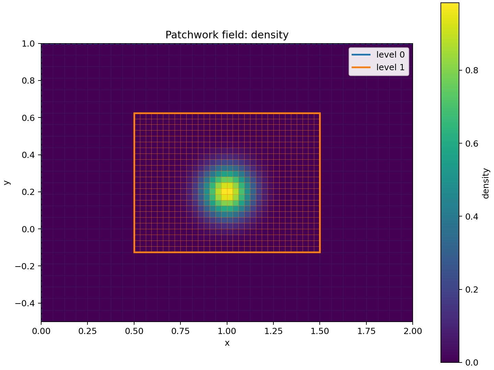
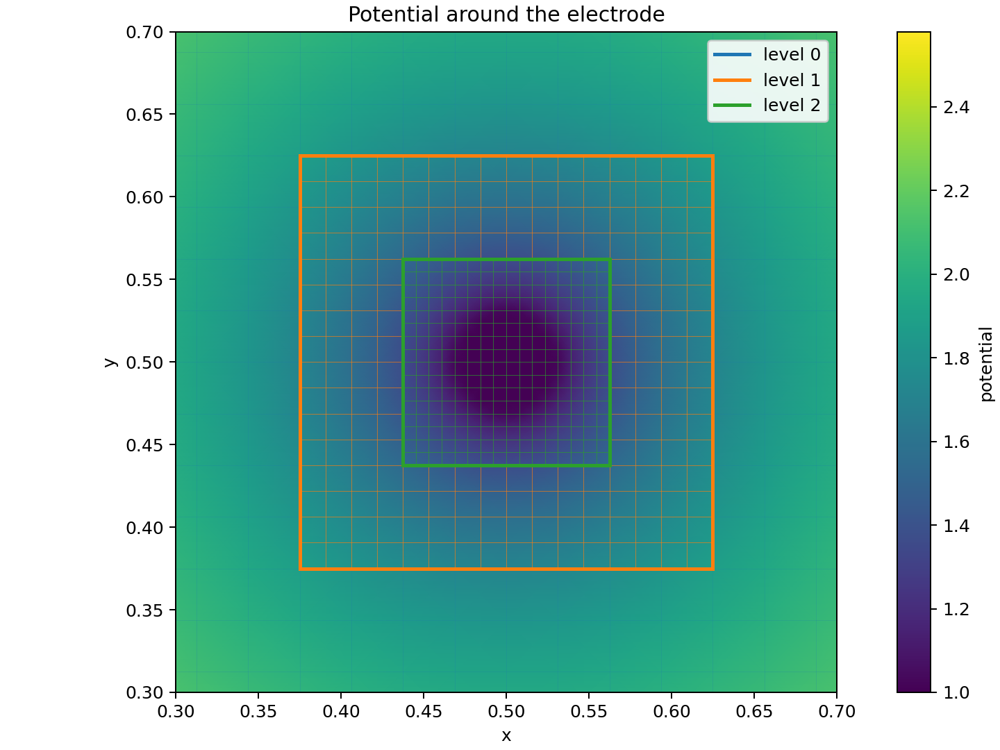
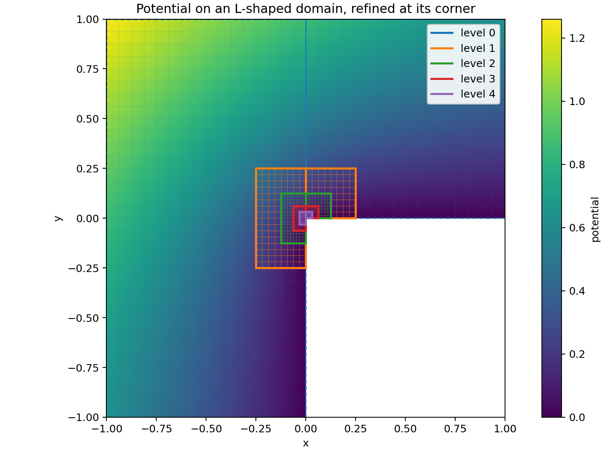
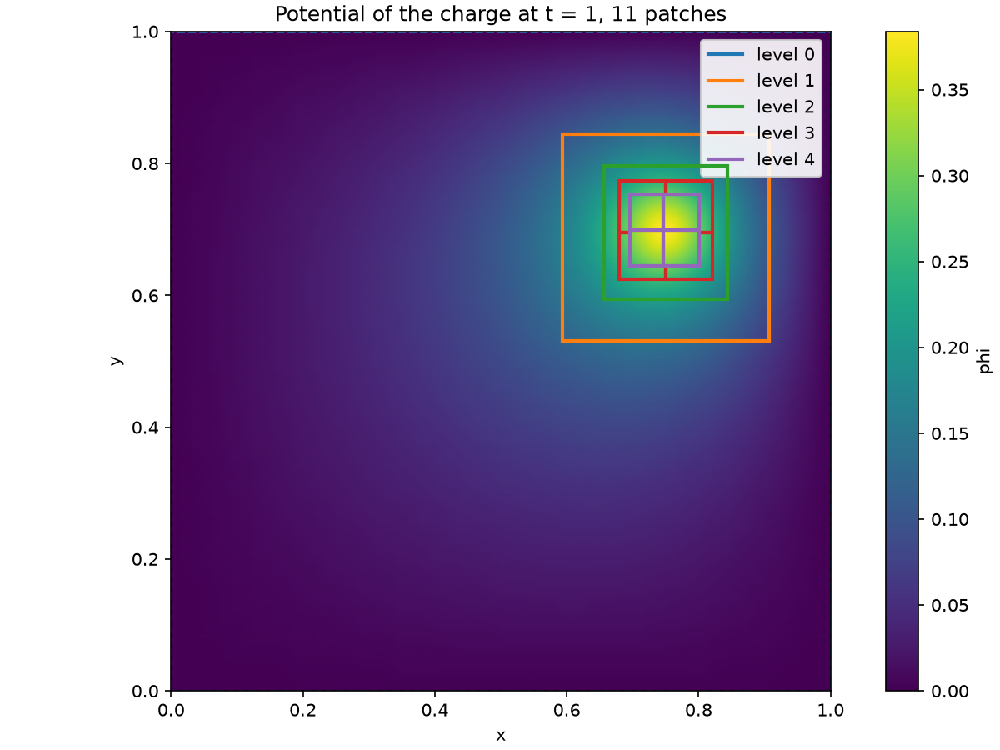

<!-- README.md is generated from README.qmd: edit the .qmd and run `make readme`. -->

[](https://github.com/max-models/patchwork/actions/workflows/test_pytest.yml)
[](https://github.com/max-models/patchwork/actions/workflows/static_analysis.yml)
[](https://max-models.github.io/patchwork/)
[](https://codecov.io/gh/max-models/patchwork)
[](https://pypi.org/project/patchwork/)
[](https://pypi.org/project/patchwork/)

Patchwork is a small 2D block-structured adaptive mesh library. It stores
cell-centered or node-centered fields on nested rectangular patches using
[`mpiarray`](https://github.com/max-models/mpiarray). The same API works
without MPI installed or launched; under `mpiexec`, after installing the
optional `mpi` extra, each patch lives on the ranks you give it (one for a small
patch, several for a large one) with a communicator of its own, and
`exchange_halos` fills every patch's halo from its neighbours and the level
below, wherever they are. Matplotlib plots make the level layout and each patch's cell grid
visible.

It provides hierarchy construction, patch validation, mpiarray-backed field
storage, plotting, and two composite Poisson solves:

- `solve_poisson`: cell-centered finite volumes with one constant Dirichlet
  value on the domain boundary;
- `NodalPoisson`: node-centered, the five-point Laplacian wherever the mesh is
  uniform, with Dirichlet and Neumann faces, periodic axes and embedded bodies
  at fixed potentials. It is factorized once and solved many times, which is
  what a particle-in-cell code needs.

`regrid` places the patches itself: tag the cells that need finer cells (by a
field's change across a cell, a function of the position, or by hand), and it
covers them with properly nested patches (Berger-Rigoutsos clustering) and moves
the fields over.

Markers live on the patches too: `locate` finds the finest patch of each point,
`owner` and `migrate` put each marker on the rank that holds its cell, and
`deposit` spreads the charge of the markers over the nodes (cloud-in-cell) patch
by patch. `accumulate_halos` then brings it to the composite nodes: the halos of
the blocks and the copies of a node in several patches are added to one copy, the
one `CompositeNodes.from_patches` reads, so the charge is that of
`CompositeNodes.deposit`, to round-off. `regrid` can fill the halos afterwards
(`fill_halos`), keep patches off given cells (`forbid`, for example a periodic
seam) and off one-cell-wide shapes (`min_patch_size`); a patch can be placed by a
function (`placement`) and a large one split over ranks (`max_cells_per_rank`).

A distributed composite solve is planned next.

## Quick example

```python
from patchwork import AMRHierarchy, plot_patches

mesh = AMRHierarchy(base_shape=(32, 24))
fine = mesh.add_patch(level=1, box=((16, 48), (12, 36)))
mesh.allocate_field("density")
fine.field("density").local[:] = 1.0
fig, ax = plot_patches(mesh, field="density")
fig.savefig("mesh.png", dpi=180)
```



## Node-centered Poisson solve

```python
import numpy as np
from patchwork import AMRHierarchy, Dirichlet, EmbeddedDirichlet, Neumann, NodalPoisson

mesh = AMRHierarchy(base_shape=(32, 32), periodic=(False, True))
mesh.add_patch(level=1, box=((24, 40), (24, 40)))
solver = NodalPoisson(
    mesh,
    faces={"x_lower": Neumann(0.0), "x_upper": Dirichlet(100.0)},
    embedded=[
        EmbeddedDirichlet(
            inside=lambda p: np.hypot(p[0] - 0.5, p[1] - 0.5) < 0.05, value=-20.0
        )
    ],
)
x, y = solver.nodes.coordinates.T
potential = solver.solve(np.exp(-((x - 0.3) ** 2 + (y - 0.5) ** 2) / 0.01))
```

`solver.solve` can be called again with another source at the cost of two
triangular solves. Nodes of a fine patch in the middle of a coarser cell's edge
take the interpolated value of the edge's ends, so the potential is continuous
across patch boundaries.



## Domains that are not rectangles

The base level can be several boxes of cells. Their union is the domain, and
the edges inside the bounding rectangle are a boundary of their own, `"inner"`:

```python
mesh = AMRHierarchy(
    base_shape=(32, 32),
    bounds=((-1.0, 1.0), (-1.0, 1.0)),
    base_boxes=[((0, 16), (0, 32)), ((16, 32), (16, 32))],  # an L
)
solver = NodalPoisson(mesh, faces={"x_upper": Dirichlet(1.0), "inner": Neumann(0.0)})
```



Patch boxes use half-open integer cell bounds on their own refinement level.
The default refinement ratio is two. For runnable layouts and a manufactured composite solve, see
[`examples/two_level_mesh.py`](examples/two_level_mesh.py),
[`examples/nested_patches.py`](examples/nested_patches.py),
[`examples/composite_poisson.py`](examples/composite_poisson.py),
[`examples/nodal_electrode.py`](examples/nodal_electrode.py),
[`examples/l_shaped_domain.py`](examples/l_shaped_domain.py),
[`examples/t_shaped_domain.py`](examples/t_shaped_domain.py), and
[`examples/regrid_moving_charge.py`](examples/regrid_moving_charge.py).

## Regridding

Tag the cells that need finer cells, and `regrid` covers them with properly
nested patches and moves the fields over:

```python
# the cells to refine: also function_tags(...), or a boolean array per level
tags = gradient_tags(mesh, "rho", threshold=10.0)
mesh = mesh.regrid(tags, max_patch_size=32)  # a new hierarchy, with the fields
solver = NodalPoisson(mesh)  # numbered and factorized again
potential = solver.solve("rho")
```

A field allocated with `conservative=True` (a density) keeps its integral
through every regrid. In
[`examples/regrid_moving_charge.py`](examples/regrid_moving_charge.py) a charge
crosses a grounded box and the mesh is regridded at every step: four levels on a
32 x 32 base, about 5,000 unknowns instead of 261,121 for a uniform mesh as fine
as the finest patches. Tagging, regridding, rebuilding the solver and solving
take about 21 ms per step on one core of an Apple M1, as long as one solve on the
uniform mesh, which also needs 0.9 s to factorize; the two potentials agree to
0.13%.



## Profiling

patchwork ships [scope-profiler](https://github.com/max-models/scope-profiler)
regions around its expensive operations (halo exchanges, restriction, deposit and
migration, tagging and regridding, building and solving the Poisson problems), named
`patchwork.<operation>`. They are off by default, so an application that
profiles itself records only its own regions. Turn them on with the `patchwork`
tag:

```python
import scope_profiler as sp

sp.setup(enable_tags=["patchwork"])  # or sp.session(enable_tags=["patchwork"])
```

or, without editing the code, `SCOPE_PROFILER_ENABLE_TAGS=patchwork`,
`scope-profiler run --enable-tag patchwork`, or `enable_tags` in the TOML
configuration. Switched off, a region costs less than 0.2 µs per call.

## Install

With [uv](https://docs.astral.sh/uv/):

```bash
make install    # uv sync --extra dev, plus the pre-commit hooks
uv run python examples/two_level_mesh.py
```

Or create and activate a Python environment (3.10 or newer):

```bash
python -m venv env
source env/bin/activate
pip install --upgrade pip
```

Install the code and requirements with pip:

```bash
pip install -e ".[plot]"  # add ,mpi for MPI-enabled runs
```

Run the code with:

```bash
python examples/two_level_mesh.py
```

The `plot` extra installs Matplotlib. The `test`, `docs` and `dev` extras install the test
runner, documentation tooling and linters:

```bash
pip install -e ".[dev]"
```

## Development

Formatting and linting use [ruff](https://docs.astral.sh/ruff/), type checking
[pyright](https://microsoft.github.io/pyright/), run by [pre-commit](https://pre-commit.com/)
and in CI:

```bash
make lint     # ruff check, ruff format --check, pyright
make test     # pytest with coverage
```

Commit messages follow [Conventional Commits](https://www.conventionalcommits.org/); see
[CONTRIBUTING.md](CONTRIBUTING.md).

## Build docs

The documentation in `docs/` is an Astro + Starlight site: hand-written pages, the notebooks
in `tutorials/` executed and published as pages, and the API reference generated from the
docstrings with [starlight-pydocs](https://ewels.github.io/starlight-pydocs/). It needs
Node 22 or newer.

```bash
make docs-install     # npm packages and the Python docs extra
make docs-notebooks   # execute tutorials/*.ipynb and convert them to pages
make docs-dev         # live preview at http://localhost:4321/patchwork/
make docs-build       # the static site in docs/dist
```

## Build the README

`README.md` is rendered from `README.qmd` with [Quarto](https://quarto.org/):

```bash
make readme
```

## Releases

Before merging a release to `main`, update the version in `pyproject.toml`,
`src/patchwork/__init__.py` and `CITATION.cff` (including its release date), and add the release
notes to `CHANGELOG.md`. The push to `main` creates a GitHub release with a `vX.Y.Z` tag and
publishes the package to PyPI with trusted publishing (OIDC). The one-time PyPI and GitHub
configuration is described in the
[publishing guide](https://max-models.github.io/patchwork/development/publishing/).
